<picture>
  <source media="(prefers-color-scheme: dark)" srcset="assets/header-dark.svg">
  
</picture>

<p align="center">
  <a href="https://darindj.github.io/MyWebsite/"></a>
  <a href="https://www.linkedin.com/in/darin-davis-johnson/"></a>
  <a href="mailto:darinjohn23@gmail.com"></a>
</p>

I turn noisy signals into decisions. Right now that means brain recordings at **KIST** in Seoul, where I build the research software and AI behind mouse-neuroscience experiments while doing my master's in AI & Robotics. Before that it meant bank customers, faces on a webcam and a 50-member association's website.

```python
darin = Researcher(
    now      = "M.S. AI & Robotics @ UST–KIST  +  student researcher @ KIST",
    research = ["neural oscillations", "burst detection", "RFID animal tracking"],
    believes = "a model nobody understands changes nothing",
    open_to  = ["applied data / AI roles", "research collaborations", "websites for small businesses"],
)
```

### ⚡ Recently shipped

| | Project | What it does |
|:-:|---|---|
| 🩺 | [**KBarn-HealthCheck**](https://github.com/DarinDJ/KBarn-HealthCheck) | Daily health check for an RFID mouse-tracking setup. It flags missing or stuck mice and antenna and logger faults, and explains each fix in plain language. |
| 📡 | [**rpi5-rfid-camera-setup**](https://github.com/DarinDJ/rpi5-rfid-camera-setup) | Turns a bare Raspberry Pi 5 into an RFID + camera data-collection node, with a manual guide and a one-shot setup script. |
| 🧠 | **Neural Burst Analysis** *(research, private)* | Cleans brain-recording signals, detects oscillatory bursts and compares them statistically across experimental conditions. |
| 🏦 | [**Bank_Customer_Churn**](https://github.com/DarinDJ/Bank_Customer_Churn) | Six classifiers compared on 10,000 customers, with the best one wrapped in a small desktop app for instant predictions. |
| 🌐 | [**Keraleeyam**](https://keraleeyam.vercel.app) | A full-stack site for a 50+ member association, built with a team of five. Database-driven content cut manual work by 60%. |
| 〰️ | [**MyWebsite**](https://darindj.github.io/MyWebsite/) | My portfolio, designed as a live brain-wave signal. Scroll through the δ θ α β γ bands. |

### 🧰 Toolkit

<p>
  
</p>

<sub>Also: MNE-Python · SciPy · statsmodels · pandas · Keras · Power BI · Jupyter</sub>

### 🛰️ Trajectory

```
2022 ──── B.Tech CSE (Data Science) · Christ University, Bengaluru · internships at HAL & Microhard
2025 ──── Research intern · IKST, Bengaluru · time-frequency analysis on large EEG datasets
2026 ──── Research intern · KIST, Seoul · Python tools for neural oscillation analysis
2026 ──── M.S. AI & Robotics · UST–KIST School  +  student researcher @ KIST
  ▍ ───── next: applied AI where the technical work moves real outcomes
```

<picture>
  <source media="(prefers-color-scheme: dark)" srcset="assets/divider-dark.svg">
  
</picture>

<p align="center"><sub>Signal is everywhere. Most of the job is removing the noise.</sub></p>
